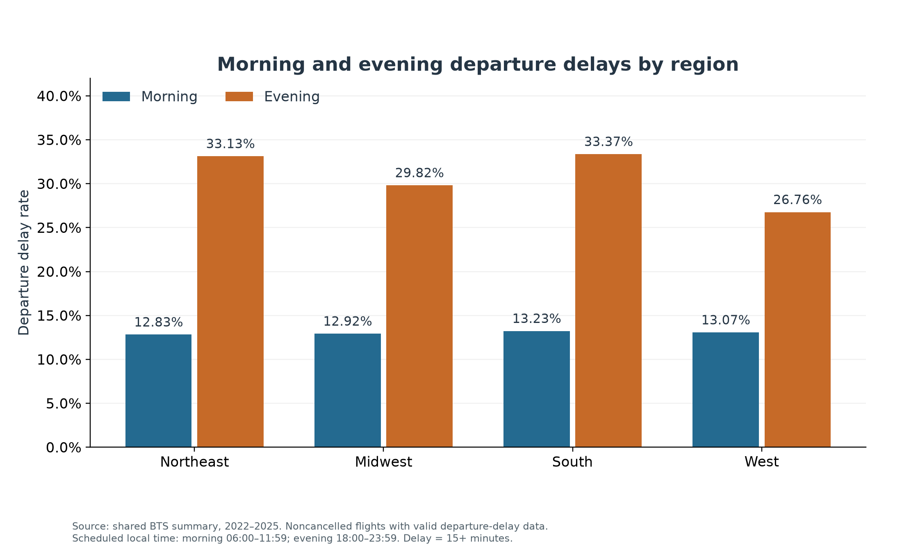
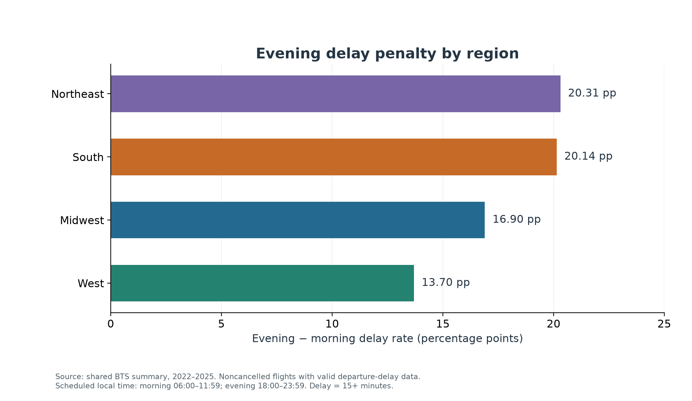
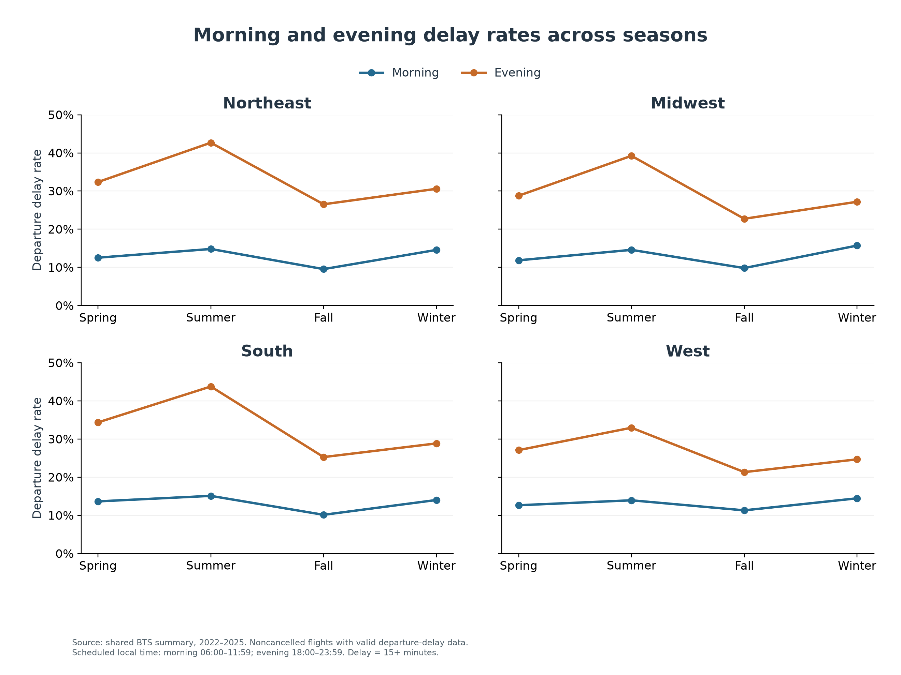
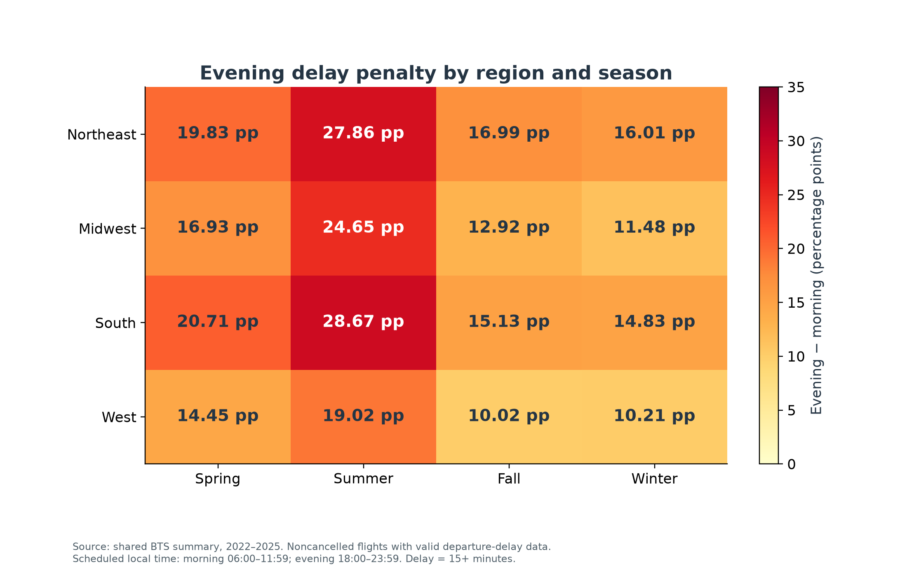
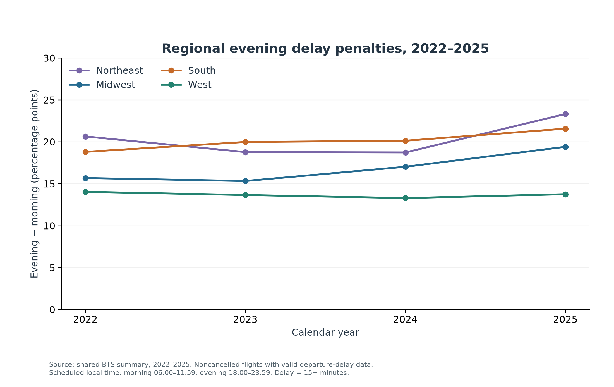

# Member 4 — Geographic analysis results

## Research question

Does the evening flight delay penalty vary across U.S. geographic regions, and how does the pattern change across seasons?

## Regional comparison

The shared dataset contains 16,665,904 eligible flights in 1,781 aggregate rows for 2022–2025. Rates pool the reporting airlines and years using flight counts as weights. The evening penalty is the evening delay rate minus the morning delay rate, measured in **percentage points (pp)**.

| Region | Morning flights | Evening flights | Morning delay rate | Evening delay rate | Evening penalty |
|---|---:|---:|---:|---:|---:|
| Northeast | 1,363,777 | 688,702 | 12.83% | 33.13% | 20.31 pp |
| South | 4,148,104 | 2,644,119 | 13.23% | 33.37% | 20.14 pp |
| Midwest | 1,714,586 | 924,764 | 12.92% | 29.82% | 16.90 pp |
| West | 3,334,479 | 1,847,373 | 13.07% | 26.76% | 13.70 pp |

The evening rate exceeds the morning rate in 4 of the four regions. Northeast has the largest pooled penalty (20.31 pp), and West has the smallest (13.70 pp), a difference of 6.61 pp. The two highest penalties, Northeast and South, differ by only 0.17 pp, so they should be described as similar in magnitude rather than as a strong ranking distinction.

## Region × season

Each cell below is an evening-minus-morning difference in percentage points, with all four calendar years pooled.

| Region | Spring | Summer | Fall | Winter |
|---|---:|---:|---:|---:|
| Northeast | 19.83 | 27.86 | 16.99 | 16.01 |
| Midwest | 16.93 | 24.65 | 12.92 | 11.48 |
| South | 20.71 | 28.67 | 15.13 | 14.83 |
| West | 14.45 | 19.02 | 10.02 | 10.21 |

Summer has the largest evening penalty in every region. The largest region–season penalty is South in Summer (28.67 pp; morning 15.11%, evening 43.78%). The smallest is West in Fall (10.02 pp). Evening rates exceed morning rates in 16 of the 16 region–season combinations.

## Annual descriptive check

Evening penalties are positive in 16 of the 16 region–year combinations. Their magnitudes vary:

- Northeast: 18.74–23.33 percentage points across the four years.
- Midwest: 15.34–19.42 percentage points across the four years.
- South: 18.81–21.58 percentage points across the four years.
- West: 13.30–14.05 percentage points across the four years.

These are separate annual summaries, not a regression that controls for year.

## Interpretation and limits

The results show a geographic association in the observed morning–evening difference. The wider summer gaps motivate further investigation of weather, traffic volume, and disruptions carried forward from earlier flights. These are hypotheses; this summary has no weather, airport-level, or individual-flight timing data to test them.

Airline mix, airport mix, season mix, and year mix can differ between morning and evening flights and across regions. These pooled differences are unadjusted and do not establish a causal effect of geography. Member 5's binomial model can assess whether the TimeOfDay × Region association persists after including Airline, Season, and Year. The seasonal patterns also motivate a TimeOfDay × Region × Season interaction if the model scope permits it.

This analysis describes the included BTS reporting flights, not every U.S. flight. Cancelled flights and flights without usable departure-delay data were excluded upstream. Cancellation risk is a separate outcome. No p-values or confidence intervals are claimed here: flights can share airport, day, and weather disruptions, and the available aggregates cannot recover those clusters.

The supplied file contains all Year × Region × Season × TimeOfDay combinations. However, it has no Month column. The repository lists 48 planned monthly inputs, but this aggregate alone cannot independently verify that every month was fully processed. Winter means January, February, and December within each calendar year, not a continuous cross-year winter.

## 中文要点

- 使用各组延误航班数和总航班数相加后计算延误率，不能直接平均原表的 DelayRate。
- Northeast 的早晚延误率差距最大（20.31 个百分点），West 最小（13.70 个百分点）。排名前两名只差 0.17 个百分点，幅度非常接近。
- 四个地区的早晚差距都在夏季最大。最大的地区与季节组合为 South 的 Summer（28.67 个百分点）。
- 这里的 penalty 是延误率差值，不是延误分钟数，也不是相对百分比增幅。地理差异与天气之间的因果关系不能由当前汇总数据直接证明。

See [README](README.md) for definitions, data provenance, and reproduction commands. The tables and this report are regenerated by the analysis script.
